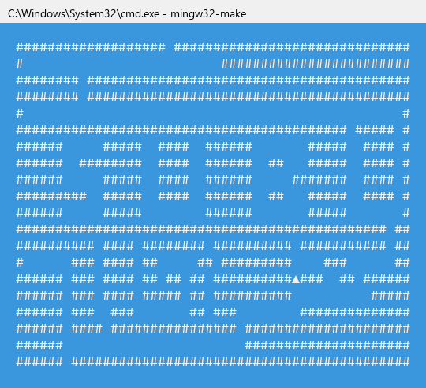
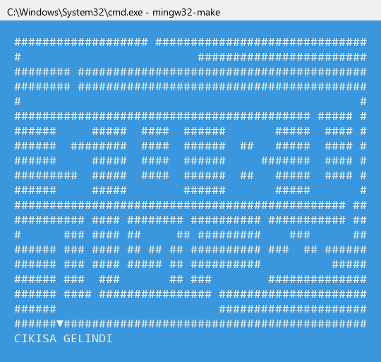

# Labirent Oyunu: Yığıt ile Backtracking

Sakarya Uygulamalı Bilimler Üniversitesi, Bilgisayar Mühendisliği **Veri Yapıları** dersi proje uygulaması.

Program, `Harita.txt` dosyasındaki 20×50'lik labirenti okur ve başlangıçtan çıkışa giden yolu **yığıt (stack)** kullanarak **geri izleme (backtracking)** ile bulur. Gezintiyi konsolda, yönü gösteren ok karakterleriyle (▼ ◄ ▲ ►) adım adım canlandırır.

<p align="center">
  
  &nbsp;
  
</p>

## Özellikler

- **Kendi yığıt sınıfımız:** `std::stack` yerine bağlı liste ile yazılmış `Yigit` sınıfı kullanılıyor. `ekle` (push) ve `cikar` (pop) işlemleri O(1).
- **Haritadan bağımsız:** Başlangıç ve çıkış koda sabit yazılmadı, haritanın kenarlarındaki boşluklardan otomatik bulunuyor. `Harita.txt` değiştirildiğinde de program çalışır.
- **Titremeyen animasyon:** Her adımda ekran temizlenmiyor, imleç başa alınıp harita üzerine yazılıyor.
- **Eski ve yeni konsol desteği:** Yön karakterleri ödevde istenen `YonChr[] = {31, 17, 30, 16}` dizisinden alınıyor. Windows 11 konsolu bu kodları göstermediği için ekrana yazarken ok şekillerine çevriliyor.
- **Hata kontrolü:** Dosya yoksa, harita eksikse ya da çıkışa giden yol yoksa program çökmüyor, anlaşılır bir mesaj verip kapanıyor.

## Derleme ve Çalıştırma

Gereken: MinGW-w64 (`g++` ve `mingw32-make`). Program Windows konsol API'sini kullanıyor.

```bat
mingw32-make            :: derler ve calistirir
mingw32-make derle      :: sadece derler
mingw32-make calistir   :: sadece calistirir (./bin/Labirent.exe)
```

Program `Harita.txt` dosyasını çalıştırıldığı klasörden okur. Çıkış bulunursa `CIKISA GELINDI`, bulunamazsa `CIKIS BULUNAMADI` yazar.

## Harita Biçimi

- 20 satır × 50 sütun (`YUKSEKLIK`, `GENISLIK` sabitleri: `include/Labirent.hpp`)
- `#` duvar, boşluk ise yürünebilir yol.
- Kenarlar üst satır → sol sütun → sağ sütun → alt satır sırasıyla taranır. Bulunan **ilk** boşluk başlangıç, **son** boşluk çıkış olur.
- Örnek haritada başlangıç `Konum(0, 19)`, çıkış `Konum(19, 6)`. Konumlar `Konum(satır, sütun)` biçimindedir.

## Algoritma

```
yigit.ekle(baslangic)
while (yigit bos degil)
    simdiki = yigit.getir()                 // yigitin tepesi = bulunulan yer
    ciz(simdiki)
    if (simdiki == cikis) -> "CIKISA GELINDI"
    ziyaret edilmemis bir komsuya gidilebiliyorsa (once duz, sonra sag, sonra sol)
        yigit.ekle(komsu)                   // ileri adim (push)
    degilse
        yigit.cikar()                       // cikmaz sokak: geri don (pop)
"CIKIS BULUNAMADI"
```

Her hücre en fazla bir kez yığıta girip çıktığı için zaman ve bellek karmaşıklığı **O(M×N)**. Örnek haritada program 157 ileri adım ve 45 geri dönüşle 113 hücrelik bir yol buluyor.

## Proje Yapısı

```
LabirentOyunu/
├── include/
│   ├── Konum.hpp       Yon enum'u, Konum sinifi (satir, sutun, yon)
│   ├── Yigit.hpp       Dugum ve Yigit (bagli liste ile yigit)
│   └── Labirent.hpp    Labirent sinifi, YUKSEKLIK / GENISLIK
├── src/
│   ├── Konum.cpp
│   ├── Yigit.cpp
│   ├── Labirent.cpp    dosya okuma, cizim, backtracking (coz)
│   └── main.cpp
├── bin/                Labirent.exe (derlenince olusur)
├── lib/                .o dosyalari (derlenince olusur)
├── docs/               ekran goruntuleri
├── Harita.txt
├── makefile
└── ProjeRaporu.docx
```

## Testler

Program şu testlerden geçti:
- Yığıt ve `Konum` birim testleri
- Farklı dosya biçimleri: LF/CRLF satır sonları, sonundaki boşlukları silinmiş satırlar, eksik ya da kapalı haritalar
- 403 haritalık çözüm testi (rastgele labirentler dahil). Her haritada sonuç bağımsız bir BFS ile karşılaştırıldı.
- Animasyondaki her karede okun yönünün yapılan hareketle aynı olduğunu kontrol eden test

Ayrıntılar `ProjeRaporu.docx` dosyasında.

## Hazırlayanlar

- Talha Cüce ([@talhacuce87](https://github.com/talhacuce87))
- Enes Yıldırım ([@Yildiran23](https://github.com/Yildiran23))

Ders sorumlusu: Doç. Dr. Selman HIZAL
